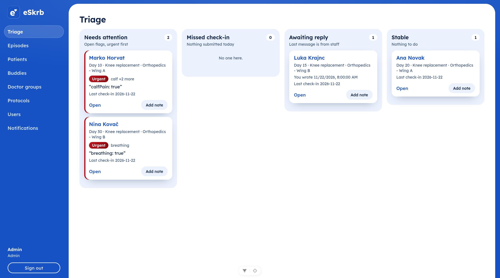
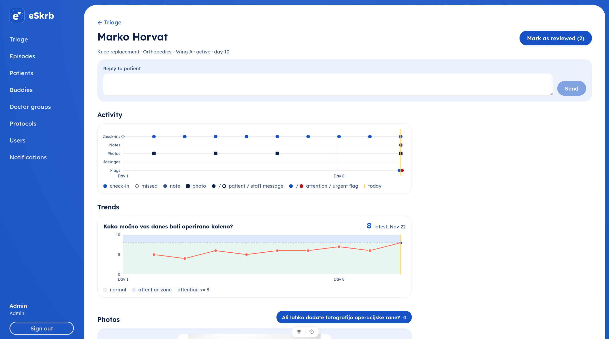
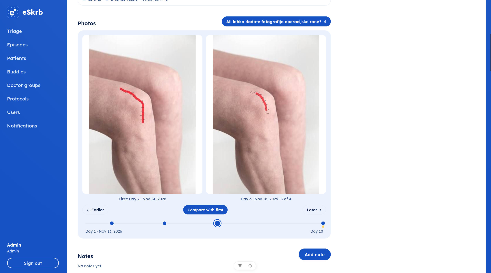
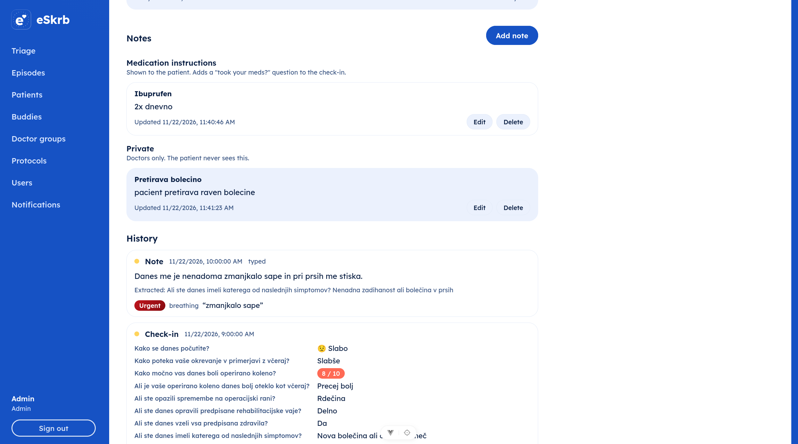
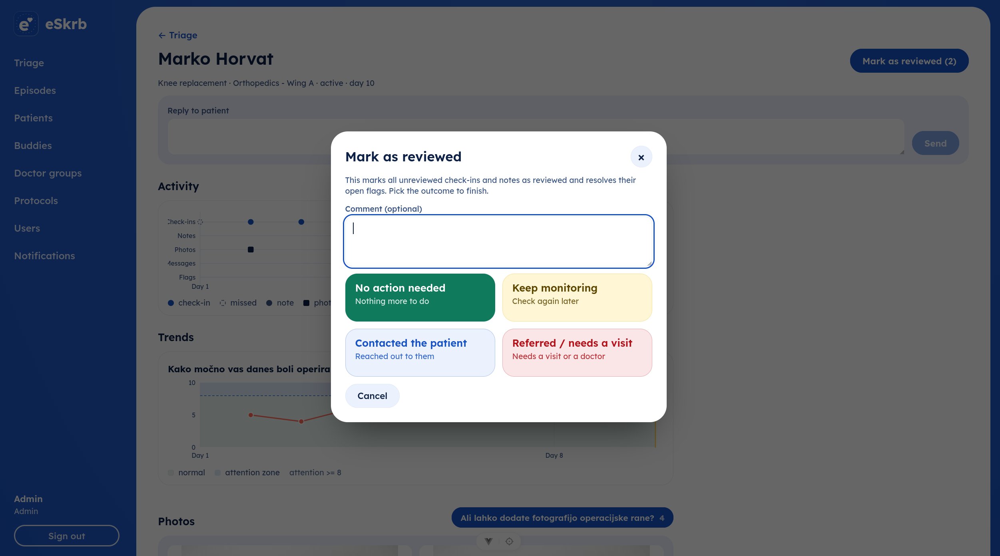
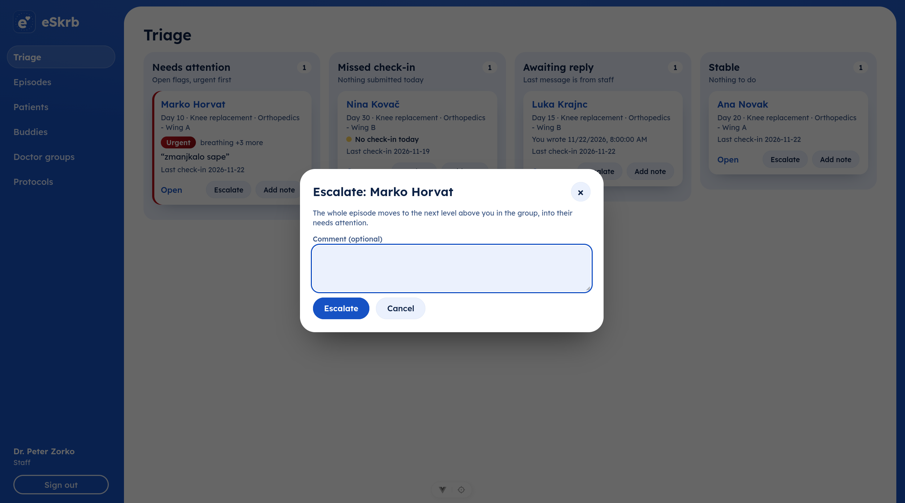

# eSkrb

A post-discharge recovery companion for patients, built for Ada Hack 2026.
Patients check in daily on their phone, the backend turns what they say into clear red-flag rules, and the clinic's staff
see who needs attention, respond, and watch the recovery over time.

<p align="center">
  
</p>

<table>
  <tr>
    <td width="50%"><br><sub><b>Episode overview:</b> activity over time and trends with attention/urgent zones</sub></td>
    <td width="50%"><br><sub><b>Wound photo timeline:</b> slide through the days, compare with the first photo</sub></td>
  </tr>
  <tr>
    <td width="50%"><br><sub><b>Notes and history:</b> medication, advice and private notes; check-ins with labelled answers and flags</sub></td>
    <td width="50%"><br><sub><b>Mark as reviewed:</b> one tap records the outcome</sub></td>
  </tr>
  <tr>
    <td width="50%"><br><sub><b>Escalate:</b> hand an episode to the next level with a comment</sub></td>
    <td width="50%"></td>
  </tr>
</table>

> The patient app is an Expo (React Native) app that lives in a separate repo. This repo holds the **backend API** and the
> **staff dashboard**.

Login code for medical staff
```
esk_MjaRlQT6s2xdhDu8hlwSl3Ci0HWDoM1Mndn-6lTNurk
```

Live domain [eskrb.home.sync.si](https://eskrb.home.sync.si)

## What it does

**For patients (via the phone app, through this API)**
- A daily check-in questionnaire (Slovenian, formal "vi"): feeling, progress, pain, swelling, wound, exercises, medication,
  symptoms. It is driven entirely by data: conditional follow-up questions (only asked when an earlier answer calls for them),
  multi-choice answers, optional wound photos, and an immediate **safety stop** (call 112) for breathlessness, chest pain or fainting.
- Free-text notes and photos, typed or **dictated** (speech-to-text runs phone to Soniox; the backend never receives audio).
- The result of every check-in is one of `none`, `contact_team` or `call_112`, decided by a rules engine, never by an AI.
- Messages from the care team, medication/advice notes, and push notifications.
- A **recovery twin**: staff pair two patients at a similar stage; they see each other's first name, day and streak, and can
  send context-aware cheers and short messages.

**For staff (this dashboard)**
- **Triage board:** needs attention, missed check-in, awaiting reply, stable. Mark items reviewed with an outcome, escalate to a senior doctor.
- **Episode page:** activity timeline, charts with attention/urgent zones, a wound-photo timeline with a slider, notes (medication, advice, private), messages.
- Doctor groups with levels (first responder, senior), episodes, protocols, patients, buddy pairing and thread moderation, manual push notifications (admin).

**AI, kept on a short leash:** an LLM only extracts values and exact quotes from free text (OpenAI, plain text extraction, nothing stored by the provider).
The deterministic **rules engine** decides every flag.

## Stack
ASP.NET Core (.NET 10) controllers, EF Core with SQLite (swappable to PostgreSQL), opaque bearer tokens, RFC 9457 errors, OpenAPI/Swagger;
Vue 3 + TypeScript + Pinia + Vue Router (Vite); xUnit tests (126).

## Run it
```bash
dotnet run --project api            # http://0.0.0.0:5000, Swagger UI at /
cd web && npm install && npm run dev  # dashboard on :5173, proxies /api to :5000
dotnet test                         # unit + in-process integration tests
```
Seed and demo data: `./reseed.sh` (dev seed) or `./reseed.sh --demo` (10 patients at different recovery stages, no check-in today,
all buddy-paired; for judging). It keeps registered push devices. Swagger at `/` documents the contract; mobile-facing guides are in
`docs/` (`checkin-questions.md`, `uploads.md`, `buddy.md`). Project conventions and architecture: `CLAUDE.md`; product plan: `PLAN-backend.md`; backlog: `APITODO.md`.

## Secrets and configuration
Secrets are never committed. Set them with .NET user-secrets (development) or environment variables (`Section__Key`, e.g. `OpenAI__ApiKey`) in production.

| Secret | Needed for | Required? |
|---|---|---|
| `Soniox:ApiKey` | Speech-to-text temporary keys for dictation (`POST /stt/temporary-key`). Needs the "Temporary API keys" + `transcribe_websocket` permissions. | For dictation. Without it the endpoint returns 503. |
| `OpenAI:ApiKey` | LLM extraction of values and quotes from free-text notes. | Optional. Without it notes are stored but raise no flags. |
| `Expo:AccessToken` | Expo "enhanced push security" for push notifications. | Optional (only if enabled in the Expo account). |
| `Seed:Tokens:<user>` | Fixed demo login tokens for the seeded users. | Optional. If unset, tokens are generated and logged once at first start. |

Non-secret settings: `ConnectionStrings:Default`, `Media:Path`, `Seed:Profile` (`dev`/`demo`), `Soniox:BaseUrl`, `Soniox:KeyTtlSeconds`,
`OpenAI:BaseUrl`, `OpenAI:Model`, `OpenAI:Effort`, `Notifications:Enabled`, `Expo:PushUrl`, `Triage:MissedCutoffHour`.

```bash
dotnet user-secrets set Soniox:ApiKey <key> --project api
dotnet user-secrets set OpenAI:ApiKey <key> --project api
```

## Target deployment: EU / Slovenia (assumption)
The health data in this app is special-category data under GDPR, so the plan assumes everything runs in an EU region (ideally Slovenia):
- **Hosting:** the API and dashboard on an EU/Slovenian cloud, behind TLS; SQLite replaced by PostgreSQL and the local photo directory by EU object storage (both are behind seams: EF provider and `IMediaStore`).
- **Speech-to-text:** Soniox on its EU endpoint, `Soniox:BaseUrl=https://api.eu.soniox.com`, with an EU-region key and a signed data processing agreement.
- **LLM:** OpenAI's EU data-residency endpoint, `OpenAI:BaseUrl=https://eu.api.openai.com/v1`, with an EU-region project key; requests use `store: false`.
- **Push:** notification texts are generic (no names or health details) because lock screens are public.

For the hackathon the demo runs with demo data only (no real patients), and the clinical thresholds in the protocol are placeholders pending clinical review.
